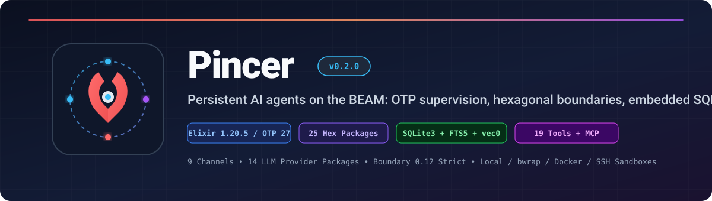
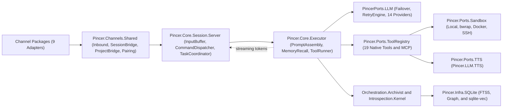
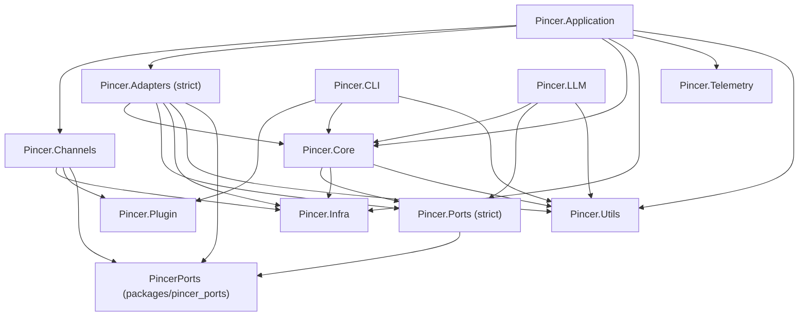
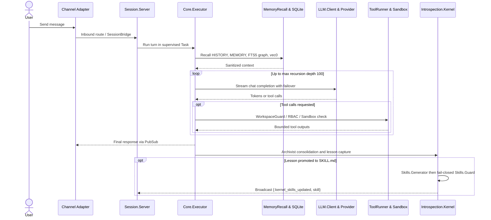
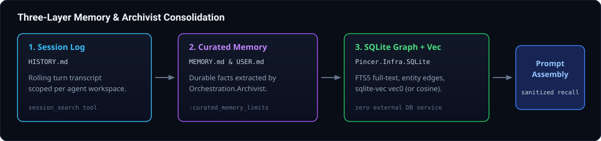

<p align="center">
  
</p>

<p align="center">
  <a href="CHANGELOG.md"></a>
  <a href="https://github.com/manelsen/Pincer/actions/workflows/ci.yml"></a>
  
  
  
  
  
  <a href="LICENSE"></a>
</p>

<p align="center">
  <a href="#quickstart">Quickstart</a> ·
  <a href="#architecture">Architecture</a> ·
  <a href="#configuration">Configuration</a> ·
  <a href="#monorepo-packages">Packages (25)</a> ·
  <a href="#built-in-tools-and-mcp">Tools (19 / 67 actions)</a> ·
  <a href="#development">Development</a> ·
  <a href="docs/README.md">Docs Index</a>
</p>

---


**Pincer** is an Elixir/OTP framework for persistent AI agents on the BEAM. Each agent owns an isolated workspace, runs inside a supervised `GenServer` session, calls **67 tool actions across 19 native modules** plus dynamically discovered MCP servers, and communicates over **9 channels** backed by **14 LLM provider packages**.

Persistence uses embedded SQLite3 (`exqlite`) with FTS5 full-text search and optional `sqlite-vec` vector indexing, so no external database service is required. Architecture boundaries are verified at compile time with `boundary` `0.12` and `warnings_as_errors: true`.

Use Pincer when you want fault-tolerant, stateful assistants across chat platforms, scheduled jobs, and workspace tools. Skip Pincer if you only need a stateless HTTP wrapper around one LLM call or a short-lived serverless function.

---

## Quickstart

### Docker

Run the single-container stack with prebuilt `sqlite-vec` support:

```bash
git clone https://github.com/manelsen/Pincer.git && cd Pincer
cp .env.example .env
# Add at least one API key in .env (for example, GROQ_API_KEY)
docker compose up --build -d
docker compose exec pincer-server mix pincer.chat
```

### Local Elixir

Prerequisites: Elixir `1.20.5+` and Erlang/OTP `27+`. Storage uses embedded SQLite3, so no PostgreSQL or Docker dependency is required locally:

```bash
git clone https://github.com/manelsen/Pincer.git && cd Pincer
mix deps.get
./scripts/build_sqlite_vec.sh   # Optional: builds priv/sqlite_vec/vec0.{so,dylib}
mix pincer.setup --yes          # Runs onboarding and initializes data/pincer.db
mix pincer.chat                 # Starts interactive CLI session
```

Verify configuration, database health, and security posture after setup:

```bash
mix pincer.doctor --strict
mix pincer.security_audit --strict
```

---

## Architecture

Pincer follows a compile-time enforced Hexagonal Architecture. Dependencies point inward toward `Pincer.Core`, `Pincer.Ports`, and `PincerPorts`.

### End-to-end runtime pipeline



### Compile-time `Boundary` `0.12` dependency map

Every architectural layer declares explicit `use Boundary` exports and `deps`. Compiler warnings fail the build via `elixirc_options: [warnings_as_errors: true]`.



Inside `Pincer.Core`, 9 internal slices enforce inbound and outbound checks via `CoreSubBoundariesTest`: `Session`, `Project`, `Executor`, `Memory`, `Orchestration`, `Introspection`, `Skills`, `LLM`, and `Graph`. `Pincer.Ports` depends only on `PincerPorts`, never on `Pincer.Infra`.

### Agentic turn and closed-loop skill promotion



### OTP supervision tree

`Pincer.Application` starts a `one_for_one` supervision tree (`lib/pincer/application.ex`) with Horde clustering support, ETS heir recovery, and isolated per-session and per-project workers:

```mermaid
flowchart TD
  SUP["Pincer.Supervisor (one_for_one)"] --> HEIR["Pincer.Utils.ETSTableHeir"]
  SUP --> CLUS["Cluster.Supervisor & NodeObserver"]
  SUP --> OBS["PromEx, PubSub, Memory & Conversation Observability"]
  SUP --> SQL["Pincer.Infra.SQLite & Finch Pool"]
  SUP --> HB["Pincer.Core.Heartbeat & Task Supervisors"]
  SUP --> MCP["Pincer.MCP.Supervisor & MCP.Manager"]
  SUP --> KRN["Introspection.Kernel.Supervisor & Kernel.Registry"]
  SUP --> SES["Session.Registry, HordeSupervisor & Session.Supervisor"]
  SUP --> PRJ["Project.Registry, HordeSupervisor, Supervisor & Recovery"]
  SUP --> GUARD["CircuitBreaker, RateLimiter, Pairing.Store & HookDispatcher"]
  SUP --> SCHED["Cron.Scheduler, TimerServer & Channels.Supervisor"]
  SUP --> HTTP["Bandit HTTP (/health)"]
```



### Three-layer memory and Archivist

<p align="center">
  
</p>

1. **Session log (`HISTORY.md`)**: Rolling transcript log for active and archived turns, searchable via `session_search`.
2. **Curated memory (`MEMORY.md` and `USER.md`)**: Consolidated notes written by `Pincer.Core.Orchestration.Archivist`, capped by `:curated_memory_limits`.
3. **Semantic graph (`Pincer.Infra.SQLite`)**: Typed nodes and edges with FTS5 full-text indexing and `sqlite-vec` (`vec0`) embeddings, falling back to in-process cosine similarity when the native extension is absent.

### Sandbox backends (`Pincer.Ports.Sandbox`)

Shell execution passes `SafeShell` and `WorkspaceGuard` path and flag checks before reaching the configured sandbox adapter:

- **`Pincer.Adapters.Sandbox.Local`** (default): Supports `:tool_registry` (MCP), `:os` (confined `sh -c`), and `:bwrap` (Linux bubblewrap namespace isolation with `prlimit` CPU, RAM, PID, and file caps; fail-closed boot probe). See [Bubblewrap Sandbox Guide](docs/operations/bubblewrap-sandbox.md).
- **`Pincer.Adapters.Sandbox.Docker`**: Ephemeral container runner using `--cap-drop ALL`, `--security-opt no-new-privileges`, `--network none`, `--tmpfs` scratch mounts, and workspace bind confinement.
- **`Pincer.Adapters.Sandbox.SSH`**: Hardened remote execution with `BatchMode=yes`, strict host-key verification, remote workspace validation, and optional `ControlMaster` multiplexing.

### Execution limits and sub-agent budgets

Compile-time limits live in `config/config.exs`: `:max_recursion_depth` (`100`), `:tool_max_concurrency` (`10`), `:tool_result_max_chars` (`32_000`), `:max_inline_bytes` (`6_291_456`), `:approval_timeout_ms` (`600_000`), plus sub-agent tree depth, token, and wall-clock caps enforced on `orchestrator` (`dispatch_agent`).

---

## Configuration

Pincer separates compile-time defaults (`config/config.exs`), runtime configuration (`config.yaml` loaded by `Pincer.Infra.Config`), and secrets (`.env` loaded via `dotenvy`).

| Surface | Controls | Examples |
|---|---|---|
| `config/config.exs` | Provider adapters, defaults, limits | `:llm_providers`, `:tts_adapter`, `:max_recursion_depth` |
| `config.yaml` | Active channels, LLM, storage, sandbox | `llm.provider`, `channels.*`, `storage.path`, `mcp.servers` |
| `.env` | API keys and channel tokens | `GROQ_API_KEY`, `OPENROUTER_API_KEY`, `TELEGRAM_BOT_TOKEN` |

### Embedded SQLite environment variables

| Variable | Effect |
|---|---|
| `PINCER_SQLITE_PATH` | SQLite file path (`data/pincer.db` by default; `:memory:` in `:test`) |
| `PINCER_STORAGE` | Storage adapter selector (only `sqlite` or `sqlite3` is accepted) |
| `PINCER_SQLITE_VEC` | Vector extension mode: `auto`, `true`, `false`, `1`, or `0` |
| `PINCER_SQLITE_VEC_PATH` | Path to compiled `vec0.so` or `vec0.dylib` |
| `PINCER_SQLITE_VEC_DIMENSIONS` | Vector embedding width (default `1024`) |

Build the optional native vector extension with `./scripts/build_sqlite_vec.sh` (details in [sqlite-vec Operations Guide](docs/operations/sqlite-vec.md)).

### Multi-agent routing and pairing (Telegram)

Route distinct DM senders to separate isolated workspaces (`workspaces/<agent_id>/.pincer/`) via `config.yaml` or pair dynamically using `/pair <code>` generated by `mix pincer.agent pair <id>`:

```yaml
# config.yaml
channels:
  telegram:
    enabled: true
    adapter: "Pincer.Channels.Telegram"
    token_env: "TELEGRAM_BOT_TOKEN"
    agent_map:
      "123456": "annie"
      "789012": "lucie"
```

### MCP servers

External MCP tool servers configured in `config.yaml` connect at startup via `MCP.Manager` (`stdio` or HTTP) and appear alongside native tools. Direct MCP `run_command` tools are blocked so shell calls always pass `SafeShell` and `WorkspaceGuard`.

```yaml
# config.yaml
mcp:
  servers:
    github:
      command: npx
      args: ["-y", "@modelcontextprotocol/server-github"]
```

---

## Monorepo packages

All 25 local Elixir subpackages under `packages/` share version `0.2.0` (`~> 0.2` inter-package constraints), compile with `warnings_as_errors: true`, and pass standalone build checks (`elixir scripts/check_packages.exs`).

### Foundation packages (3)

| Package | Path | Responsibility |
|---|---|---|
| `pincer_ports` | [packages/pincer_ports](packages/pincer_ports) | Pure `PincerPorts.*` behaviours and shared structs (`Channel`, `LLM`, `Messaging`, `Project`, `PubSub`, `Session`, `SkillsRegistry`, `Streaming`, `UX`) |
| `pincer_shared` | [packages/pincer_shared](packages/pincer_shared) | Shared channel pipeline (`Inbound`, `SessionBridge`, `ProjectBridge`, `Pairing`, `Chunking`, `Formatting`, `Attachments`, `TokenCache`, `WebhookVerifier`) |
| `pincer_openai_compat` | [packages/pincer_openai_compat](packages/pincer_openai_compat) | Shared OpenAI-compatible HTTP adapter and `__using__/1` defaults macro |

### Channel packages (9)

Each channel package ships its canonical `priv/pincer_plugin.yaml` manifest in byte parity with `priv/plugins/<id>/pincer_plugin.yaml`.

| Channel | Package | Adapter Module | Required Secrets / Setup |
|---|---|---|---|
| CLI | [pincer_cli](packages/pincer_cli) | `Pincer.Channels.CLI` | Interactive terminal (`mix pincer.chat`); enabled by default |
| Telegram | [pincer_telegram](packages/pincer_telegram) | `Pincer.Channels.Telegram` | `TELEGRAM_BOT_TOKEN` |
| Discord | [pincer_discord](packages/pincer_discord) | `Pincer.Channels.Discord` | `DISCORD_BOT_TOKEN` |
| Slack | [pincer_slack](packages/pincer_slack) | `Pincer.Channels.Slack` | `SLACK_BOT_TOKEN`, `SLACK_APP_TOKEN` |
| WhatsApp | [pincer_whatsapp](packages/pincer_whatsapp) | `Pincer.Channels.WhatsApp` | Go `1.21+` sidecar (`PINCER_WHATSAPP=1` to test) |
| LINE | [pincer_line](packages/pincer_line) | `Pincer.Channels.Line` | `LINE_CHANNEL_ACCESS_TOKEN`, `LINE_CHANNEL_SECRET` |
| DingTalk | [pincer_dingtalk](packages/pincer_dingtalk) | `Pincer.Channels.DingTalk` | `DINGTALK_CLIENT_ID`, `DINGTALK_CLIENT_SECRET` |
| Feishu / Lark | [pincer_feishu](packages/pincer_feishu) | `Pincer.Channels.Feishu` | `FEISHU_APP_ID`, `FEISHU_APP_SECRET` (+ optional `base_url`) |
| Webhook | [pincer_webhook](packages/pincer_webhook) | `Pincer.Channels.Webhook` | Bearer token env + loopback Bandit ingress |

### LLM provider packages (13)

13 provider packages export 14 `PincerPorts.LLM.Provider` modules (plus `Pincer.LLM.Providers.OpenAICompat` and `Pincer.LLM.TTS` via `Pincer.Ports.TTS`):

| Package | Provider Module(s) | Capabilities / Notes |
|---|---|---|
| [pincer_anthropic](packages/pincer_anthropic) | `Pincer.LLM.Providers.Anthropic` | Messages API and streaming |
| [pincer_google](packages/pincer_google) | `Pincer.LLM.Providers.Google` | Native PDF and inline image support (`supports_files: true`) |
| [pincer_openai](packages/pincer_openai) | `Pincer.LLM.Providers.OpenAI` | Chat, streaming, and embeddings via `OpenAICompat` |
| [pincer_openrouter](packages/pincer_openrouter) | `Pincer.LLM.Providers.OpenRouter` | Multi-model routing and `baai/bge-m3` embeddings |
| [pincer_groq](packages/pincer_groq) | `Pincer.LLM.Providers.Groq`, `GroqWhisper` | Fast chat inference and Whisper audio transcription |
| [pincer_ollama](packages/pincer_ollama) | `Pincer.LLM.Providers.Ollama` | Local model discovery and chat |
| [pincer_mistral](packages/pincer_mistral) | `Pincer.LLM.Providers.Mistral` | Chat and embeddings via `OpenAICompat` |
| [pincer_deepseek](packages/pincer_deepseek) | `Pincer.LLM.Providers.DeepSeek` | DeepSeek chat via `OpenAICompat` |
| [pincer_moonshot](packages/pincer_moonshot) | `Pincer.LLM.Providers.Moonshot` | Kimi / Moonshot chat via `OpenAICompat` |
| [pincer_zhipu](packages/pincer_zhipu) | `Pincer.LLM.Providers.Zhipu` | GLM standard and coding endpoints |
| [pincer_qwen](packages/pincer_qwen) | `Pincer.LLM.Providers.Qwen` | Qwen chat via `OpenAICompat` |
| [pincer_minimax](packages/pincer_minimax) | `Pincer.LLM.Providers.MiniMax` | Dual `Authorization` + `Authority` group header |
| [pincer_opencode_zen](packages/pincer_opencode_zen) | `Pincer.LLM.Providers.OpencodeZen` | OpenCode Zen endpoint ([setup guide](docs/OPENCODE_ZEN_SETUP.md)) |

---

## Built-in tools and MCP

`Pincer.Adapters.NativeToolRegistry` registers **19 native modules** exposing **24 function schemas** and **67 actions**, all implementing `Pincer.Ports.Tool`:

| Tool Module | Registered Name(s) | Capabilities |
|---|---|---|
| `Tools.FileSystem` | `file_system` | Confined `Walk`, `Edit` (anchored/hashline), `Archive` (`zip`/`unzip`), and `Transfer` (`copy`/`move`/`.trash`) |
| `Tools.SafeShell` | `safe_shell` | Allowlisted shell commands validated and re-validated via `WorkspaceGuard` |
| `Tools.Web` | `web_search`, `web_fetch` | Outbound search and fetch pinned through `NetworkGuard` SSRF checks |
| `Tools.Browser` | `browser` | Headless browser actions validated against private/loopback network targets |
| `Tools.Media` | `media` | Image `describe`/`ocr`, sandboxed `pdf_extract` (`pdftotext`), `Pincer.Ports.TTS`, and `transcribe` |
| `Tools.GitHub` | `github` | Repositories, issues, PRs, comments, commits, and code search |
| `Tools.GitInspect` | `git_inspect` | Workspace-confined `status`, `diff`, `log`, `blame`, `branches`, `show`, and `stash` |
| `Tools.Orchestrator` | `orchestrator` | Bounded sub-agent dispatch and durable checkpoint `status` inspection |
| `Tools.BlackboardReader` | `blackboard_reader` | Scoped reads from `Core.Orchestration.Blackboard` |
| `Tools.Workflow` | `workflow` | Session, agent, project, board, and atomic `tasks.json` workflow actions |
| `Tools.Scheduler` | `scheduler` | Cron schedule creation and management via `Adapters.Cron.Scheduler` |
| `Tools.Timer` | `timer` | Delayed reminder timers via `Adapters.Tools.TimerServer` |
| `Tools.GraphMemory` | `graph_memory` | Semantic knowledge graph queries and updates in SQLite |
| `Tools.SessionSearch` | `session_search` | Transcript and SQLite full-text search across sessions |
| `Tools.CodeSkeleton` | `code_skeleton` | Structural symbol outlines for workspace source files |
| `Tools.Learning` | `learning` | Preference and lesson persistence |
| `Tools.ExternalKnowledge` | `external_knowledge` | Grounded external knowledge retrieval |
| `Tools.ChannelActions` | `channel_actions` | Cross-channel messaging through `PincerPorts.Messaging` |
| `Tools.Config` | `config` | Surgical `config.yaml` key updates preserving sibling sections |

---

## CLI and Mix tasks

### Interactive CLI (`mix pincer.chat`)

- `/status`: Query local or distributed session status (`Idle` or `Working`, session ID, agent, active model).
- `/history`, `/history N`, `/history clear`: Inspect or clear persisted CLI prompt history.
- `/clear`: Clear terminal output.
- `/quit` or `/q`: Exit the interactive REPL.

In chat channels, `Pincer.Core.UX` drives `/new`, `/reset`, `/model`, `/think`, `/reasoning`, `/menu`, `/project`, `/kanban`, and `/pair` from one canonical command catalog.

### Mix tasks

| Task | Purpose |
|---|---|
| `mix pincer.setup [--yes] [--sqlite-path <path>]` | First-run dependency, onboarding, SQLite init, and health bootstrap |
| `mix pincer.onboard` | Interactive configuration wizard |
| `mix pincer.server [channels]` | Start persistent OTP server node with enabled channels |
| `mix pincer.chat` | Attach interactive CLI frontend (distributed or standalone) |
| `mix pincer.agent new <id> \| pair <id>` | Scaffold agent workspace or generate pairing code |
| `mix pincer.plugins` | Inspect and toggle channel plugin status |
| `mix pincer.doctor [--strict] [--config <path>]` | Config, SQLite, FTS5, `sqlite-vec`, LLM, and kernel checks |
| `mix pincer.security_audit [--strict] [--config <path>]` | Gateway bind, workspace restriction, DM policy, and sidecar isolation audit |
| `mix pincer.memory.report` | Print memory and graph statistics |
| `mix pincer.memory.explain` | Explain stored memory diagnostics |
| `mix pincer.full_sync` | Synchronize semantic graph index |
| `mix pincer.purge_indices` | Purge invalid search indices |

---

## Development

### Quality gates

```bash
mix qa                  # format --check-formatted + compile --warnings-as-errors + test (--max-failures 1)
mix sprint.check        # Same full gate without --max-failures
mix boundary.spec       # Print compile-time Boundary graph
mix test.quick          # Run stale tests only
elixir scripts/check_packages.exs            # Compile and test all 25 isolated packages (requires Go for WhatsApp)
elixir scripts/check_packages.exs pincer_telegram   # Verify one isolated package
```

### Targeted tests and posture checks

```bash
mix test                                     # Full ExUnit suite on in-memory SQLite (:docker, :bwrap, :chaos, :stress excluded)
mix test --only docker                       # Opt-in real container Docker sandbox E2E
mix test --include bwrap                     # Opt-in Linux bubblewrap integration test
OPENROUTER_API_KEY=ci-posture-check mix pincer.doctor --strict --config test/fixtures/ci_posture/config.yaml
OPENROUTER_API_KEY=ci-posture-check mix pincer.security_audit --strict --config test/fixtures/ci_posture/config.yaml
```

### Repository metrics (`0.2.0`)

- `289` Elixir source files in `lib/`
- `111` Elixir source files across `25` packages in `packages/`
- `350` ExUnit test files (`*_test.exs`, including `28` architectural guard suites under `test/pincer/architecture/`)
- `19` native tool modules (`24` function schemas, `67` actions), `9` channel packages, `13` LLM provider packages

Regenerate these counts at any commit with:

```bash
printf "lib=%s pkg_ex=%s packages=%s tests=%s arch=%s\n" \
  "$(find lib -name '*.ex' | wc -l)" \
  "$(find packages -path '*/lib/*.ex' -o -path '*/lib/**/*.ex' | sort -u | wc -l)" \
  "$(ls -1d packages/*/ | wc -l)" \
  "$(find test -name '*_test.exs' | wc -l)" \
  "$(find test/pincer/architecture -name '*_test.exs' | wc -l)"
```

## Governance and security

- Documentation index: [docs/README.md](docs/README.md)
- Contributing workflow: [CONTRIBUTING.md](CONTRIBUTING.md)
- System specifications: [SPECS.md](SPECS.md)
- Release history: [CHANGELOG.md](CHANGELOG.md)
- Security policy: [SECURITY.md](SECURITY.md)
- Code of conduct: [CODE_OF_CONDUCT.md](CODE_OF_CONDUCT.md)
- License: [MIT](LICENSE)
