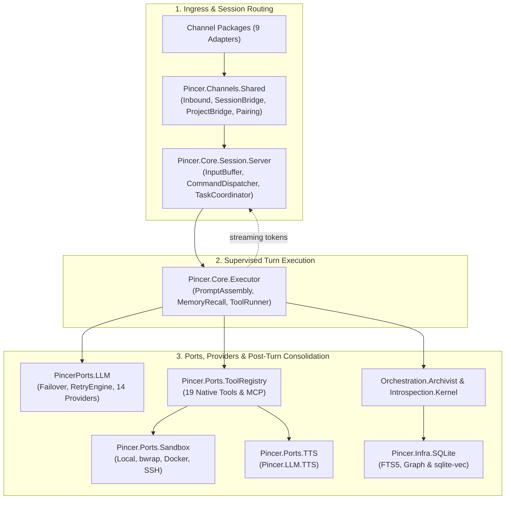
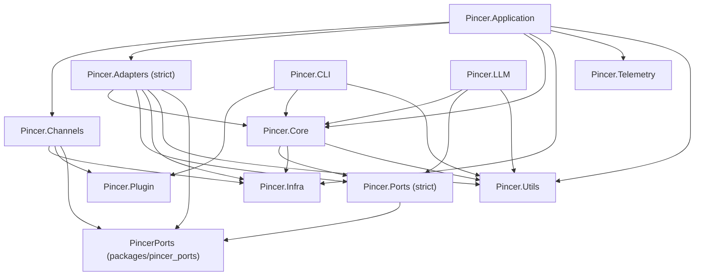
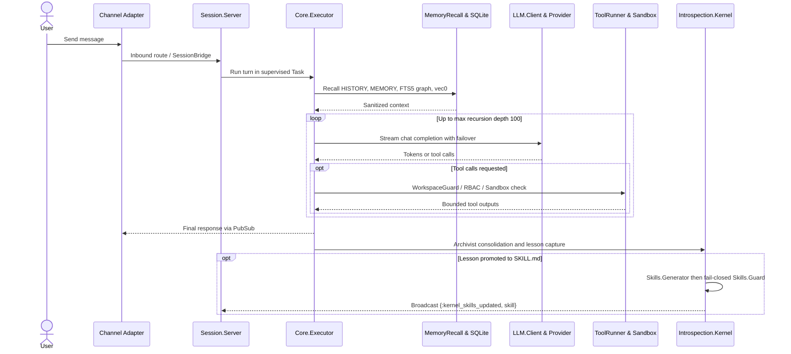

# Technical Architecture Reference (`0.2.0`)

This reference expands the high-level diagrams in [README.md](../../README.md) with module-level Mermaid graphs derived from `lib/pincer/application.ex`, layer `use Boundary` declarations, and the `Core.Executor` turn loop.

For historical boundary context predating `0.2.0`, see [Architecture & Boundaries Report (2026-03-13)](2026-03-13-architecture-boundaries-report.md).

---

## End-to-end runtime pipeline

Top-down request flow from inbound messaging channels to session execution, guarded tools, LLMs, and post-turn consolidation:

---

## Compile-time `Boundary` `0.12` dependency map

Every layer declares explicit `use Boundary` `deps` and `exports`, enforced during compilation with `elixirc_options: [warnings_as_errors: true]`:

Inside `Pincer.Core`, 9 internal slices enforce inbound and outbound checks via `CoreSubBoundariesTest`: `Session`, `Project`, `Executor`, `Memory`, `Orchestration`, `Introspection`, `Skills`, `LLM`, and `Graph`. `Pincer.Ports` depends exclusively on `PincerPorts`, never on `Pincer.Infra`.

---

## Agentic turn and closed-loop skill promotion

Detailed interaction between `Session.Server`, `Core.Executor`, recall storage, tool safety guards, and fail-closed self-reflection:

---

## OTP supervision tree

`Pincer.Application` boots a `:one_for_one` supervision tree (`lib/pincer/application.ex`) ordered from durable state and clustering foundations up to ingress supervisors:

```mermaid
flowchart TD
  SUP["Pincer.Supervisor (one_for_one)"] --> HEIR["Pincer.Utils.ETSTableHeir"]
  SUP --> CLUS["Cluster.Supervisor & NodeObserver"]
  SUP --> OBS["PromEx, PubSub, Memory & Conversation Observability"]
  SUP --> SQL["Pincer.Infra.SQLite & Finch Pool"]
  SUP --> HB["Pincer.Core.Heartbeat & Task Supervisors"]
  SUP --> MCP["Pincer.MCP.Supervisor & MCP.Manager"]
  SUP --> KRN["Introspection.Kernel.Supervisor & Kernel.Registry"]
  SUP --> SES["Session.Registry, HordeSupervisor & Session.Supervisor"]
  SUP --> PRJ["Project.Registry, HordeSupervisor, Supervisor & Recovery"]
  SUP --> GUARD["CircuitBreaker, RateLimiter, Pairing.Store & HookDispatcher"]
  SUP --> SCHED["Cron.Scheduler, TimerServer & Channels.Supervisor"]
  SUP --> HTTP["Bandit HTTP (/health)"]
```

